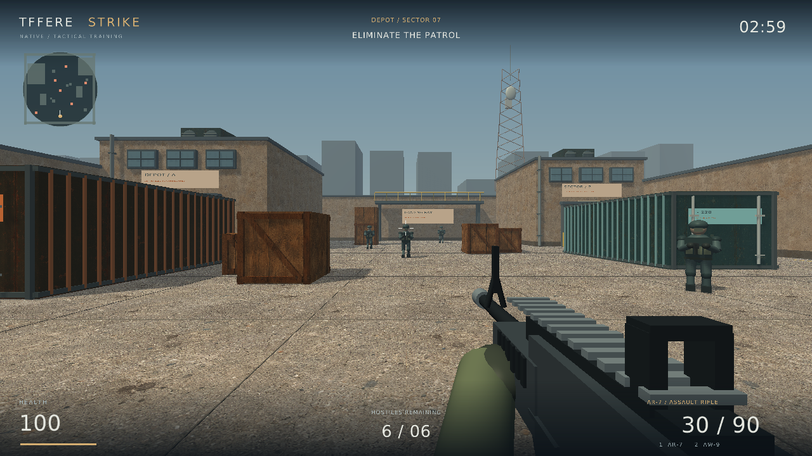
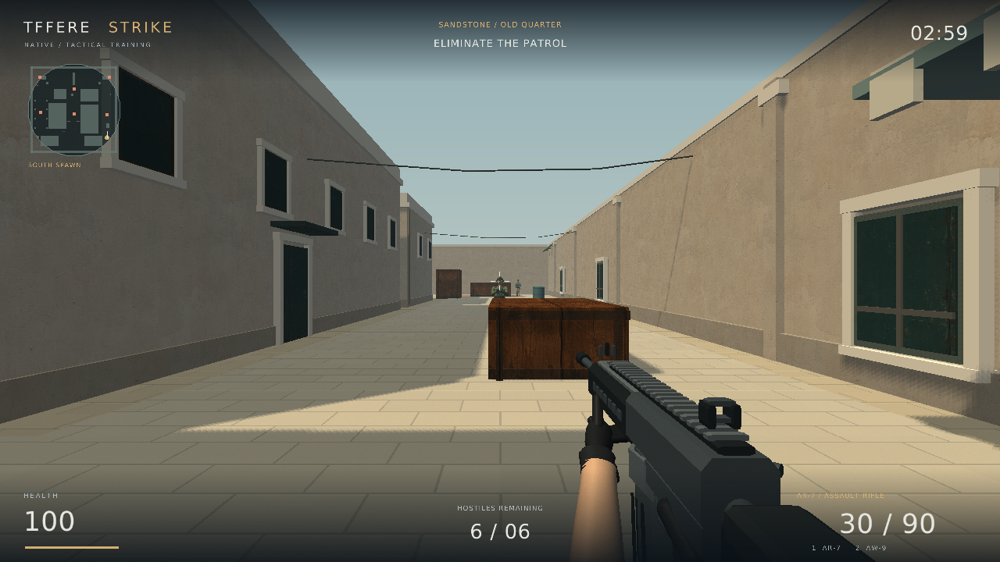
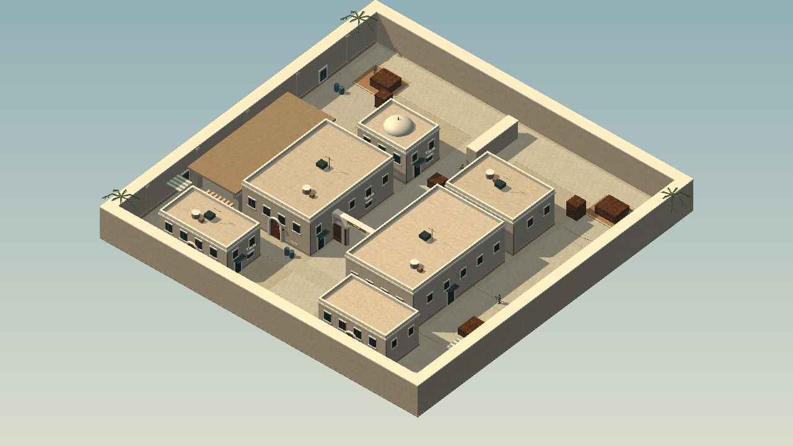

# Tffere Strike — Native C++ v1.7

A standalone Windows desktop FPS written in C++17 with raylib. Play against six bots in a connected desert quarter, choose an AR-7 rifle or AW-9 sniper, use cover, and clear the depot before the round ends.

## Download and play on Windows

1. [Download TffereStrike-Windows-x64.zip](https://github.com/tffere/tffere-strike/raw/refs/heads/main/downloads/TffereStrike-v1.7-Windows-x64.zip).
2. Right-click the ZIP and select **Extract All**. Open the extracted `TffereStrike` folder.
3. Double-click **TffereStrike.exe**. Keep its `assets` folder beside it.
4. Click **Deploy into Depot**, or press **Enter**.

No Node.js, npm, Python, browser, or development tools are needed to play. Requires Windows 10/11 x64 with an OpenGL 3.3-capable graphics driver. Extract the whole ZIP; do not run the executable from inside the archive. The executable is not digitally signed.

## Latest research: additional1000 rounds and benchmark audit

The1000-round follow-up did not establish an extra win-rate gain (fresh1000:47.7%→47.9%). **v1.7 remains the default release.** Frozen diagnostics found coarse20Hz benchmark timing differs materially from120Hz play, while the small decision table merges contexts needing different actions. Close starting spawns were not the main explanation. [Full tested hypotheses and raw evidence](training/runs/2026-11-09-winonly1000-audit/DIAGNOSTIC-REPORT.md).

## v1.7: 25 HP rifle, reaction delays and win-only learning

AR-7 body damage is25HP for both sides, head75 unchanged. Bot reaction delay is independently sampled per new/reacquired sight: uniform63–237ms, mean150ms/SD50ms. Aim/readiness and physics ticks can delay shots further. The AI-player Level0 controller uses the same delay in training; human input has no artificial delay. Broad map search uses sight/hearing evidence without tracking hidden positions.

Exactly500 win-only rounds trained the latest bot against frozen Level0, with random connected-map starts. Reward1win/0otherwise, first-visit episodic updates, no damage/time/survival bonuses. Checkpoint400 selected solely by400-game validation wins before fresh testing. On fresh500 cases, baseline37.2%→selected47.6% wins; final50045.8%. Default uses selected400; F5 switches exact starting baseline and restarts. [Full report, all50-round metrics, sniper kills and provenance](training/runs/2026-11-09-winonly500/REPORT.md). This measures one frozen opponent and spawn distribution, not general human skill.

Earlier release descriptions below are historical.

## v1.6: shared combat rules, recoil and two more training cycles

Player and bots now share weapon damage/fire rates, health, hitboxes, movement limits, ammunition/reload timing and physical recoil/spread. Rifle cooldown is 0.115 seconds; bots no longer use the old slower cadence. Same-step mutual eliminations can draw. Switching guards prevent the prior weapon-switch loop, and blocked tactical routes follow their chosen goal.

Hold **Ctrl** to crouch or **Alt** to slow walk for tighter accuracy. Sprinting and jumping widen spread. Recoil affects both the actual shot and camera; controlled bursts let it recover. Both AI controllers use the same recoil rules and bounded aim compensation.

Two more **100-round real Game::step cycles** trained separate bot and AI-player policies. Frozen 20-round tests stayed at **5 wins, 14 losses, 1 mutual elimination (25%)** before training, after 100 and after 200 rounds. No win-rate gain was measured. The game defaults to the final policy, labelled **AFTER 200 / RECOIL**. **F5** switches to the exact before-200 baseline and restarts the round. See the [full report and raw records](training/runs/2026-11-08-v1.6/REPORT.md), including earlier, separately labelled experiments.

## v1.4: crouch, bot postures and footsteps

Hold **Ctrl** to crouch: smoothly lowered view, slower movement and quieter steps. Sprint is disabled while crouching. Grounded foot position is preserved through stance changes and landing.

Bots now buckle at the knees, rotate the torso independently, release their arms, drop the weapon and settle into varied fallen poses. Falls prefer an unobstructed direction and finish even when the final kill ends the round. Knee-pad proportions and running weight shift were refined. These remain procedural animations.

Five distinct [Kenney concrete-footstep samples](https://kenney.nl/assets/impact-sounds) replace generated footstep noise. Samples vary without immediate repeats and are triggered by actual grounded travel. Crouching is quieter; nearby bots' steps have distance/pan/obstruction-based volume. Camera bob also follows actual travel. The included CC0 credit/license and exact sample hashes are in `native/assets/footsteps/`.

## v1.3: sensory awareness and bullet marks

- Bots start exploring without knowing the player location. A visible player updates their last-seen location. When sight is lost, they investigate that fixed location, search nearby for eight seconds, then resume patrolling.
- Player gunshots, actual grounded footsteps and landings produce discrete hearing events. Rifle/sniper shots travel farther than footsteps; sprinting is louder than walking. Walls reduce hearing range to 45%, and heard locations are approximate (three-metre grid), not a live player tracker.
- Hidden movement without a new audible cue cannot change a bot's target or route. Patrol destinations and starting facing directions are independent of player location. Bots do not share omniscient target information.
- Shots leave dark, chipped bullet marks on walls, buildings and cover. Marks follow the hit face, project onto visible doors/trim, remain during the round, and clear on restart. The oldest mark is replaced after 256 impacts. Body hits and sky misses do not leave floating marks.

The current Windows package passes 50 native gameplay/pose/policy cases and Microsoft Defender/ClamAV scans. Exact reports, hashes and limitations are bundled under `SCAN-REPORTS/` and recorded in [v1.7 validation](docs/security/v1.7/RECHECK.md). Scan results are not a guarantee of safety. The executable remains unsigned. A graphical Windows playtest is still needed.

For every shipped update, a new version number, Git tag, [GitHub Release](https://github.com/tffere/tffere-strike/releases) and versioned ZIP are preserved. Future patch rebuilds also receive a new version; previous versioned downloads are not overwritten.

## v1.2 bot update

Bots now run on approach, turn gradually, perform staggered jumps and crouch during combat. Longer running strides, airborne knee bends and lowered crouching poses follow gameplay state. Eye height, muzzle height and bullet hitboxes follow jumping and crouching.

Bots acquire shots within a 120-degree horizontal field of view and fire only after aiming within roughly 10 degrees of the player. Every shot rechecks visibility after movement: the eye-to-player, chest-to-muzzle and muzzle-to-player paths must all be clear of collision objects. In the historical v1.2 release, bots still navigated toward a hidden player; v1.3 replaces this with evidence-based awareness. Jumping stays on navigable ground and does not vault obstacles.

## Keep previous versions

- [v1.6: shared combat and recoil](https://github.com/tffere/tffere-strike/releases/tag/v1.6)

- [v1.5: historical experimental policy](https://github.com/tffere/tffere-strike/releases/tag/v1.5)

- [v1.4: Ctrl crouch, bot poses and sampled footsteps](https://github.com/tffere/tffere-strike/releases/tag/v1.4)

- [v1.3: sensory awareness, searching and bullet marks](https://github.com/tffere/tffere-strike/releases/tag/v1.3)

- [v1.0: original depot](https://github.com/tffere/tffere-strike/raw/refs/heads/main/downloads/TffereStrike-v1.0-Windows-x64.zip)
- [v1.1: Sandstone desert map and revised characters](https://github.com/tffere/tffere-strike/raw/refs/heads/main/downloads/TffereStrike-v1.1-Windows-x64.zip)

- [v1.2: running, jumping, crouching and stricter bot visibility](https://github.com/tffere/tffere-strike/raw/refs/heads/main/downloads/TffereStrike-v1.2-Windows-x64-rebuilt.zip)

Extract each version into a separate folder. The `v1.0` and `v1.1` Git tags preserve their source; `upgrade-desert-map` records the upgrade work. Neither download requires installing the other.

## Controls

| Input | Action |
| --- | --- |
| W / A / S / D | Move |
| Mouse | Look |
| Left mouse / hold | Fire |
| 1 / 2 | AR-7 rifle / AW-9 sniper |
| Right mouse | Toggle sniper scope |
| R | Reload; restart when paused |
| Space | Jump |
| Left Shift | Sprint; wider spread |
| Hold Alt | Slow walk; tighter spread |
| Hold Ctrl | Crouch: lower view, slower movement, quieter footsteps |
| Escape | Pause/resume; close from the start/end menu |
| Enter | Deploy / resume / new round |
| F11 | Toggle fullscreen |
| M | Mute/unmute sound |
| F3 | Show performance info |
| F4 | Toggle shadows |
| F5 | Switch baseline / after600 experimental bot policy and restart round |

## Included

- Original desert quarter with connected mid, long-road and covered-passage routes, two courts, sandstone façades, shop entrances, arches, shutters, awnings, palms and cover. Directional shadows and restrained material textures keep the routes readable.
- Revised human-proportioned patrol models with shaped faces, helmets, goggles, tactical equipment and camouflage. Distance-driven alternating strides, bent knees, breathing, smooth turning, hit reactions and animated falls replace the original rigid patrol pose.
- Chamfered rifle/sniper models with compact sights, layered rails, scope/bolt detail, fitted black gloves and shaped bare forearms, plus recoil/reload movement.
- Animated sniper zoom and reticle, separate ammunition/reload state, and distinct fire rates and damage.
- Synthesized firing/reload/hit sounds and sampled concrete footsteps. A missing audio device does not prevent play.
- Six bots with cover-aware vision/shooting and deterministic navigation around obstacles.
- Radar, hit feedback, health, ammunition, a three-minute round, pause, restart and win/loss states.

This is a compact single-player game with stylized original models, not a recreation of Counter-Strike or the earlier generated concept artwork. There is no multiplayer, matchmaking, campaign, or advanced character animation rig. The screenshots below show the v1.1 executable and map; later releases change bot behavior, animation and impacts.







## Source and builds

The native version is in [`native/`](native/). The earlier JavaScript prototype remains in the repository for reference; its instructions are in [BROWSER-PROTOTYPE.md](docs/BROWSER-PROTOTYPE.md). Use the Windows ZIP above for the current game.

CMake 3.24+, a C++17 compiler and Internet access to fetch checksum-pinned raylib 5.5 are needed to build from source. On Windows, install Visual Studio Build Tools with **Desktop development with C++**, then:

```sh
cmake -S native -B native-build -A x64
cmake --build native-build --config Release --parallel 2
ctest --test-dir native-build -C Release --output-on-failure
```

Run `native-build/Release/TffereStrike.exe`; assets are copied automatically. `.github/workflows/native.yml` defines the equivalent Windows CI build and artifact.

Linux builds require GCC/G++, CMake and standard X11/OpenGL development packages:

```sh
cmake -S native -B native-build
cmake --build native-build --parallel 2
ctest --test-dir native-build --output-on-failure
```

`native/build.py` is an alternative direct builder. Windows cross-compilation uses Zig 0.13.0:

```sh
python3 native/build.py --platform windows --zig /path/to/zig --package
```

## Validation

For v1.7, all 50 native gameplay/pose/policy tests pass on Linux and Windows, including hidden-player patrol independence, fixed last-seen memory, search expiry, muffled/discrete sound detection, grounded footsteps, bullet impact positions/caps, field of view, blocked shots, stance hitboxes and navigation. The eight earlier browser prototype tests also pass. The Windows x64 package is built with Visual Studio on a fresh GitHub Windows runner.

A graphical/listening Windows playtest of v1.7 has not been performed in this environment. The earlier v1.1 graphical smoke tests do not validate the new animation. Please try v1.7 on your Windows machine and report movement or rendering issues.

Launch with `--smoke-test` for a short graphical check and screenshot, or `--capture` for an initial gameplay view. Normal launches start at the menu.

## Assets and licenses

Game geometry and combat cues are generated by the C++ application. Footstep samples are Kenney CC0 audio, with credits and hashes in native/assets/footsteps/. The material atlas is original generated artwork bundled locally. DejaVu font license is in `native/assets/FONT-LICENSE.txt`; the raylib license is included in the downloadable package. Downloads and package hashes are in [`downloads/`](downloads/).

## Offline self-play training lab

Use the [real-game headless training program](native/training/README.md): two role-specific policies learn for 100 rounds, then the game bot is tested for 20 rounds against the saved original player policy. Only actual game-code settings should be used for future learning. The full result and model artifacts are in the [latest report](training/runs/2026-11-08-v1.6/REPORT.md). The game defaults to the final 200-round bot and includes its starting baseline as an F5 option; results do not establish broad tactical improvement.
