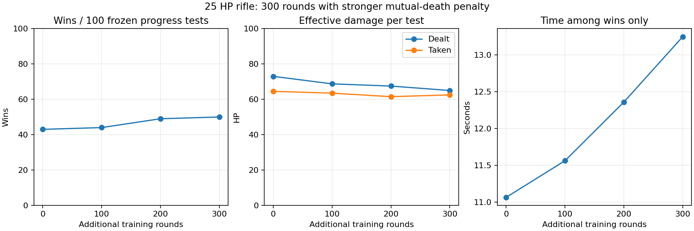

# 25 HP rifle: 300 rounds with stronger mutual-death penalty

Exactly300 real-map training rounds, three consecutive100-round bot-only cycles, latest bot continued each cycle against **AI-player Level0**, the original frozen before-player-policy.txt. Both spawn at independently seeded random connected navigation cells, minimum8m separation, independent random headings. Game::step, desert map,0.05s physics steps, no graphics/frame pacing. Simulation runs faster than wall-clock time. Both aim to kill; the AI-player reacts but NEVER learns or explores random actions. Frozen-player Q values/visits asserted unchanged per episode and original/final files match. No simplified simulator. Both sides share25body/75head AR-7 damage (36×0.7 rounded),0.115s rifle cooldown; sniper125/220,1.35s. Physical recoil/spread, health and other rules unchanged.

## Fixed progress tests (100 each, no learning or exploration)

| Additional rounds | Wins | Losses | Mutual eliminations | Timeouts | Avg damage dealt | Avg taken | Mean win seconds | Hit rate |
|---|---:|---:|---:|---:|---:|---:|---:|---:|
|0|43|29|28|0|73.00|64.50|11.07|47.6%|
|100|44|42|14|0|68.75|63.50|11.56|55.0%|
|200|49|48|3|0|67.50|61.50|12.36|65.6%|
|300|50|49|1|0|65.00|62.50|13.25|52.7%|

Same100 seeded cases at each checkpoint; starting positions/headings match across policies. Search/controller/weapon rules included BEFORE baseline, not credited to learning. Config/reward settings fixed through all3 cycles. Evaluations don't alter policies. Intermediate damage gains must be read alongside mutual eliminations and losses; damaging a target while dying is not winning or damage avoidance. Training metrics use changing policy, exploration and different encounters; they cannot establish controlled improvement.

## Every50 training rounds

| Rounds | Avg damage dealt | Avg taken | Hit rate | Mean win seconds | Wins/50 |
|---|---:|---:|---:|---:|---:|
|1–50|56.0|72.5|50.0%|18.85|14|
|51–100|69.5|73.5|71.3%|9.14|15|
|101–150|71.0|62.5|44.0%|15.23|23|
|151–200|63.0|69.0|53.7%|14.10|20|
|201–250|62.0|70.5|53.2%|9.95|19|
|251–300|57.5|70.5|56.1%|14.82|17|

## Separate final-only test cases

heldout-before: 52 wins, 33 losses, 15 mutual eliminations, 0 timeouts; damage 71.5, taken 57.75, mean winning seconds 13.8144.

heldout-after: 45 wins, 54 losses, 1 mutual eliminations, 0 timeouts; damage 62.5, taken 62.75, mean winning seconds 12.6333.

Final-only win change: -7 percentage points on100 cases. This small sample against one controller does not establish broad skill improvement. Repeated progress and separate final-only cases have disjoint seeds from training. No weight/reward selection after the final-only comparison. Final300 checkpoint is preserved even when another checkpoint scores better on one metric.

## Search, learning and metric definitions

Broad search patrols world-centered radius40 clamped to map; evidence-centered search radius12 and18s after lost contact; longer route commitment; legal sprint toward distant unseen goals. No routing from live hidden target position. This is programmed control, not a learned navigation network. Only high-level192×9 Q scores learn. Player and bot controllers still differ despite equal physical settings. Current settings favor wins/damage/survival/time via +200win,-150loss,-120timeout,+0.5 per effective HP dealt,-0.45 per HP taken,-0.02 per0.05s frame,-0.5switch,+0.05 once per new4m cell while unseen. Mutual elimination terminal penalty is recorded in config.txt; earlier campaigns used5, whereas the survival-focused campaign uses150, equal to the loss penalty. No extra optimization rounds were silently added. Alpha0.15,gamma0.998,epsilon0.25→0.05 each cycle. All configs saved.

Hit rate=PlayerHit events from bot0/BotShot events. Damage=actual health removed (capped by remaining HP). First-shot time from round start,-1 when never fires; aggregates exclude those rounds and show denominator. Visibility sampled before each0.05s frame; encounter=contiguous visible segment, can flicker. Damage/encounter is pooled damage divided by visible segment count, not a tactical engagement classifier. Visible-without-shot time includes normal cooldown; ready-visible-without-shot excludes cooldown/switch/reload/empty ammo but NOT aim misalignment. These counters alone do not prove a firing bug. Winning-time means exclude losses/draws; compared subsets differ. Unique4m cells measure traversed cells, not observable coverage. Six50-round blocks and thirty10-round blocks, all raw rounds,10-round bot checkpoints, before/after/reference policies and configs are preserved.

Reproduce with strike-campaign BOT LEVEL0 LEVEL0 EMPTY_OUT CYCLE CONFIG; cycle0 plus test-only for baseline;1→2→3 continue only bot. evaluation-games is100 for these experiments. campaign-tests checks frozen roles, spawn clearance, deterministic replay and counters/hidden-position isolation. Historical36-HP results and previous25-HP runs have different seeds and may not be directly compared as learning gains. Windows six-bot human play remains different from1v1 training.
