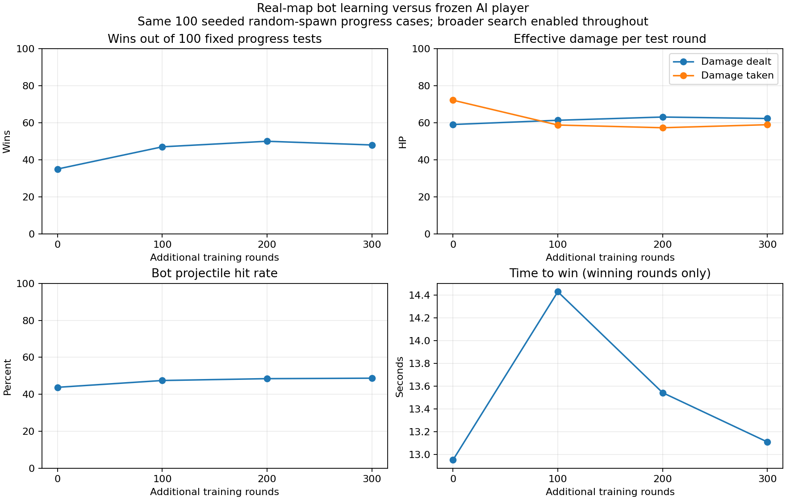
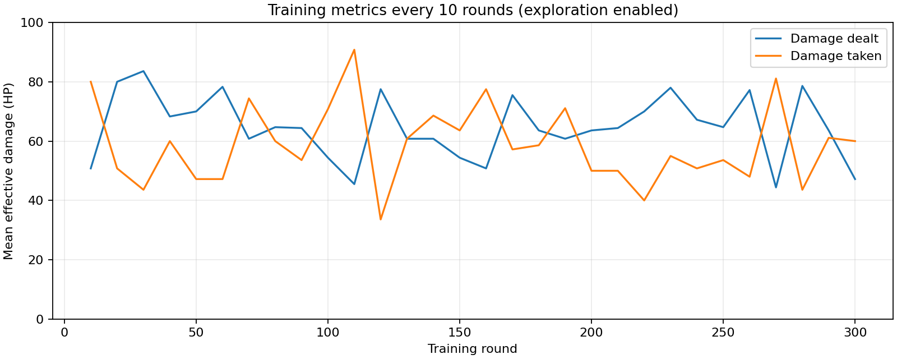

# Frozen-player campaign: 300 rounds, AR-7 body damage 36 HP

Completed three consecutive 100-round bot-only learning cycles from the v1.6 final bot against the original frozen AI-player policy. Both spawn at random valid connected navigation cells on the actual desert map, at least 8m apart, with independently randomized headings. Game::step uses 0.05s simulation steps. The opponent reacts and shoots but its policy never learns; assertions and saved before/after models verify this.

Broad search uses world-centered patrol destinations over radius40 (clamped to map), evidence-centered lost-contact search radius12 for18s, longer route commitment and legal sprinting toward distant unseen goals. It never uses hidden target coordinates for routing. This programmed search change is included BEFORE the learning baseline.

| Additional training | Wins/100 | Losses | Mutual eliminations | Mean damage dealt | Mean damage taken | Mean winning time (s) | Hit rate |
|---|---:|---:|---:|---:|---:|---:|---:|
| 0 |35|55|10|59.07|72.20|12.95|43.77%|
|100|47|52|1|61.35|58.79|14.43|47.46%|
|200|50|47|3|63.11|57.32|13.54|48.45%|
|300|48|50|2|62.30|58.96|13.11|48.70%|

No progress-test timeouts. Final300 slipped relative to200; do not claim monotonic gains. These repeated100 cases use seeds1200000–1200099, separate from training1100100–1100399. No tuning was performed between cycles. Rewards/configs are recorded per cycle: +200 win, -150 loss, -120 timeout, +0.5 per effective HP dealt, -0.45 per HP taken, -0.02 per simulated frame, -0.5 per switch, +0.05 once per newly visited4m cell while unseen. Both win/damage and survival/time tradeoffs contribute; this is Q-learning, not a neural-network training process.

A separate frozen100-case comparison, seeds1300000–1300099, was inspected only after training finished: initial39W/54L/7 mutual eliminations, final47W/48L/5 mutual eliminations. Damage57.88→62.08; taken66.04→56.27; mean time among winning games14.73→12.45s. On the35 cases won by both,13.95→13.50s. Sample-limited evidence against one specific frozen opponent, not general human skill. No learning in any evaluation.

Search-only comparison, same progress seeds and initial weights: old search26W/54L/6 mutual/14timeouts, damage40.34,46 zero-shot games; broad-search baseline35W/55L/10 mutual/0timeouts, damage59.07,16 zero-shot games. Do not credit that difference to learning.

## Metric definitions and limitations

training-blocks-10.csv gives30 blocks over300 rounds. Each cycle saves raw training/evaluation CSVs, config, bot checkpoints every10, original/final bot/player and frozen reference. Hit rate is PlayerHit events from bot0 divided by BotShot events; effective damage is actual health removed, capped by remaining HP. Visibility is sampled BEFORE each0.05s step. An encounter is a contiguous visible segment; damage per encounter is total effective damage divided by segment count, not a geometry-defined duel. Visibility can flicker or shots can occur after movement within a step. Visible-without-shot time includes normal cooldowns; ready-visible-without-shot excludes cooldown/reload/switch/ammo blocks but does NOT require aligned aim, so it is not proof of a firing bug. First-shot time is measured from round start, -1 for never-fired rounds; averages exclude them and report denominator. Winning-time averages exclude losses/draws and therefore compare different subsets; paired-comparison.json includes shared-win timing. Unique4m cells measure visited cells, not total observable map coverage.

Accuracy, sensory gating, weapon specs, health, collision and recoil otherwise remain the real v1.6 settings. The evaluated controller roles differ. Historical v1.6 25% tests had different spawns/seeds and cannot be directly compared. This campaign used36 HP body damage BEFORE the subsequent request to reduce AR-7 body damage to25. It does not establish performance under25 HP.

Reproduce with strike-campaign BOT FROZEN FROZEN EMPTY_OUT CYCLE CONFIG; cycles1,2,3 continue only the bot. For initial/evaluation-only use cycle0 and test-only. campaign-tests validates freezing, spawn clearance, deterministic replay, counter invariants and hidden-coordinate isolation. Runtime integration of a new model/search setting requires a separately versioned game release.
