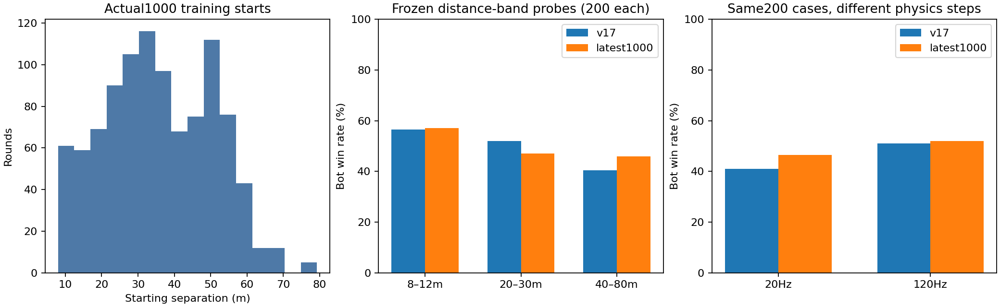

# Why playtesting can improve while frozen-policy win rate stalls

## Findings

The user's playtest observation is compatible with the results. **The shipped v1.7 bot already contains the earlier improvement.** The latest1000-round experiment asked whether an additional model improved beyond that stronger v1.7 baseline. It did not establish an aggregate improvement on its original fresh1000 cases:477→479 wins,74 gained but72 lost, paired one-sided exact p=.467, approximate paired95% difference interval−2.17 to+2.57 percentage points. This is not proof the models behave identically or that no scenario improved.

The audit found **real benchmark-fidelity and learner-capacity limitations**. It did not support close starting positions as the main explanation. No new model was deployed and v1.7 remains the current release.

| Hypothesis | Test | Finding |
|---|---|---|
| Wrong model loaded or baseline mixed up | Compare shipped ZIP assets, v1.7 source, experiment before tables and earlier selected model | No wrong model. The comparison baseline changed: earlier37.2→47.6% gain is already in v1.7; latest47.7→47.9% measures extra learning beyond it. |
| Most rounds start too close or immediately visible | Inspect all1000 actual starts; frozen near/mid/far probes and first-contact replay | Only5.3% of training starts are under12m. Standard initial bot visibility5.5%. Near starts have higher, not lower, bot win rates. Not supported as main cause. |
| Headless timing differs materially from live play | Same200 map starts/headings/policies at20Hz and120Hz, correctly scaled controller clocks; isolated timing/duel controls | Supported. Weapon cadence, realized reaction latency, mutual deaths and win rate change with step size. |
| State table merges situations needing different decisions |100 frozen snapshots all encoded as the same common state, four legal one-decision interventions each | Supported.23 snapshots have win/nonwin outcomes dependent on intervention; opposite action preferences occur within the same state code. |
| Much behavior cannot learn at all | Code/action-mask audit and sampled decision counters | Supported. About86.7% of v1.7 decision samples in the standard probe have only the programmed search action available. Navigation/aiming are programmed, not learned by the table. |
| Player-role advantage explains everything | Identical weights in both controllers, starts swapped; policies swapped between roles | Not supported as a universal explanation. Bot role often wins more in these controls. Controller/policy interactions matter and roles are not interchangeable. |
| Win counting, rewards or changing frozen weights caused the result | Raw rewards, effective health depletion, frozen hashes, golden harness parity | No mismatch found. Every learning reward equals the win indicator; original Level0 values unchanged.50 original frozen episodes match outcomes,ticks,damage and both shot counts exactly. |

These are frozen diagnostic tests, not extra training. Hypothesis probes were performed after the fresh-test gate failed; they were not used to tune or reselect a deployed model. The original gate was not overridden by a favorable exploratory subset.

## 1. Which bot was actually compared?

The shipped v1.7 ZIP's default `bot-policy-trained.txt` numerically matches the earlier win-only500 experiment's selected checkpoint400 and the starting table of this1000-round experiment. Its F5 `bot-policy.txt` is the older before-win-only baseline. Exact identity evidence is in diagnostic-probes/model-identity.json.

Earlier experiment, same500 fresh cases: old baseline186wins(37.2%)→v1.7 selected238wins(47.6%).

Latest experiment, a different1000 fresh cases: v1.7 incumbent477wins(47.7%)→new selected blend479wins(47.9%). The latest blend has NOT replaced the published game model. One cannot attribute the already shipped improvement to this later1000-round candidate.

A new frozen400-case diagnostic comparison under identical current rules also reproduces the direction of the earlier improvement: F5 before-win-only policy156wins(39%), v1.7 default180wins(45%), latest1000 blend202wins(50.5%). This is an exploratory diagnostic seed set, not a substitute for the original1000-case gate. The difference between sets illustrates scenario sensitivity.

## 2. Close spawns and actual engagement distances

Across the1000 learning episodes: minimum8m, mean35.81m, median34.75m;53/1000 start under12m and161/1000 under20m. The original fresh1000 cases are similar: median34.01m,54 start under12m. Close cases are a small fraction.

Matched frozen distance-band probes (200 cases per band, same starts/headings between incumbent and candidate):

| Starting separation | v1.7 wins | Latest blend wins | v1.7 initial sight | Median first sight distance, when seen | Median first shot distance, when firing |
|---|---:|---:|---:|---:|---:|
|8–12m|113/200(56.5%)|114/200(57.0%)|66/200|9.94m|10.10m|
|20–30m|104/200(52.0%)|94/200(47.0%)|16/200|21.55m|22.00m|
|40–80m|81/200(40.5%)|92/200(46.0%)|0/200|29.50m|27.71m|

In the standard400 v1.7 probe, only22 initially see the target;23 AI players initially see the bot. Among340 rounds where the bot ever sees the player, median first visual distance is22.66m; among321 rounds where it fires, median first-shot distance is25.32m. First-sight mean time is10.67s conditional on sight occurring. These are generally not point-blank duels.

Simultaneous first sight does occur:136 of293 standard cases where both eventually see one another have first sight recorded in the same50ms tick. It is more common in the far band(85/139) than the near band(29/153). Symmetric range/visibility boundaries and approach routes can create simultaneous contact without close initial spawns. Initial separation is not encounter distance.

Distance bands necessarily alter map positions/geometry as well as separation. These tests reject the simple claim that most rounds start too close; they do not isolate the causal effect of training on different spawn distributions, which would require new controlled learning runs. No such extra learning was performed.

## 3. Timing fidelity is a measured issue

Live main.cpp targets120FPS with variable frame time capped at50ms. Training/evaluation historically use fixed50ms steps(20Hz). Same Game::step code does not mean identical timing behavior.

| Same200 start positions/headings | v1.7 wins | v1.7 mutual deaths | Latest blend wins | Latest mutual deaths |
|---|---:|---:|---:|---:|
|20Hz,50ms steps|82(41%)|13|93(46.5%)|15|
|120Hz,8.33ms steps|102(51%)|0|104(52%)|4|

The120Hz probe scales BOTH AI-player observe/input memory, decision/navigation/switch/commitment timers, reaction timer and aim limits with supplied `dt`. It does not accidentally give the player6× aim speed. The original `.05` default remains unchanged. A50-episode golden parity check validates the diagnostic harness against historical frozen code.

Isolated engine timing controls:

| Timing quantity |20Hz|120Hz|
|---|---:|---:|
|Mean sampled delay, same50000 draws|149.736ms|149.736ms|
|Mean delay until reaction gate becomes ready|174.746ms|153.896ms|
|Rifle repeated-shot interval from0.115s spec|150ms|116.667ms|

A second controlled microprobe places two identical stationary sniper controllers20m apart, already facing one another, in obstacle-free space. Same1000 independent reaction-seed pairs,100health,125body damage, no learning:

| Step rate | Bot wins | Player wins | Mutual deaths |
|---|---:|---:|---:|
|20Hz|384|355|261(26.1%)|
|120Hz|485|459|56(5.6%)|

This microprobe isolates timing, not real-map performance. Independent reactions get rounded into the same firing tick much more often at20Hz. The real-map matched comparison shows the same reduction in mutual deaths. Both actors share specs in a20Hz test, so its within-test comparisons are still meaningful; it is a poorer proxy for finer-step live gameplay. These observations do not prove timing alone explains every human-play improvement.

## 4. The learner cannot distinguish important contexts

The policy is a192-state,9-action Q table. It receives coarse visibility/known/cover/health/ammo/range/current-weapon flags. It lacks detailed angle/cover geometry, exact readiness/reaction timing and tactical location. It does not learn aiming, recoil compensation, collision or full navigation. Current low-level code can fire whenever visible/ready even during movement actions.

In100 deliberately gathered snapshots, all had exactly the same common encoded state130: visible+known, medium range9–18m, rifle selected, not low health/ammo and not marked covered. Each snapshot was cloned with all world/controller/RNG state intact. One legal macro decision was forced for250ms—shoot,chase,left flank or right flank—then the original policy resumed. No model values changed.400 accepted counterfactual rollouts were saved.

23/100 snapshots changed win/nonwin outcome across those four choices. Opposite preferences occur inside the same state code:

| Snapshot seed | Encoded state | Shoot then resume | Chase then resume |
|---|---:|---|---|
|3500000|130|Win|Mutual death|
|3500284|130|Loss|Win|

Shoot wins while chase does not in4 snapshots; the reverse happens in1. Other action pairs also have contradictory preferences. This supports state aliasing: one table row cannot choose differently for situations it is told are identical. It does NOT mean all game states collapse to130, nor prove this is the only cause of stalled learning. It shows why more samples alone cannot teach a missing distinction.

In standard v1.7 probes, approximately86.7% of sampled decision-time masks allow only Search. The model cannot choose a better unexplored region or learn new pathfinding in those states. Search routes and much of the perceived skill are programmed. More rounds only adjust the limited high-level choices that remain available.

## 5. Role/controller controls

Identical weights were placed in both actor controllers and starting positions/headings were swapped in a second matched run:

| Same policy in both roles,800 combined cases | Bot wins | Player wins | Mutual deaths | Timeouts |
|---|---:|---:|---:|---:|
|Level0 weights|340|277|180|3|
|v1.7 weights|457|302|34|7|

These cases do not support a universal advantage for the AI-player role. They do show that equal weapon/health/reaction settings do not make controller implementations equivalent. Policy transfer between roles interacts with movement/aim/search code. We should not explain every failed improvement by assuming the player has stronger settings.

## Recommended next change, before more learning

1. Align training AND evaluation with a fixed finer physics step, initially1/120s, keeping250ms high-level decisions and all timing/counters scaled correctly. Re-establish both-policy baselines under the new rules; do not count a timestep change as a learning gain.
2. Expand observable state/context so the policy can distinguish readiness, relative angles, cover and visible opponent behavior. Do not add live hidden-position information.
3. Give unknown-target search meaningful legal choices over reachable unexplored regions; merely unmasking more action names without implementing different behavior will not help.
4. Keep reward1win/0otherwise and checkpoint/fresh-test safeguards. Validate on independent positions and do not replace the v1.7 model without a reproducible gain.

No additional learning is authorized or performed by this audit. The1000-round budget is exhausted. All frozen tests, rejected/replayed probes and counterfactuals remain diagnostics only; no new game was packaged or released.

## Evidence and reproduction

- `diagnostic-probes/probes.csv`:4800 labelled frozen map probes, policy tables unchanged.
- `contact-probes/probes.csv`:2000 contact-distance replays; every original field matches its earlier corresponding probe exactly.
- `diagnostic-probes/state-counterfactuals.csv`:100 accepted same-state snapshots×4 interventions; all first decisions verified legal/executed in state130. Capture/prelude/rejected probes also ran frozen.
- `diagnostic-probes/timing-microprobe.csv` and `symmetric-timing-duels.csv`: isolated controls, no learning.
- `native/training/audit_frozen.cpp`, `audit_frozen_support.hpp`, `audit_state_aliasing.cpp`, `audit_timing.cpp`, `audit_symmetric_duel.cpp`: reproducible source.

Build native/training with CMake. Run `strike-frozen-audit INCUMBENT CANDIDATE LEVEL0 EMPTY_OUT`; append `contact-only` for the contact replay. Run `strike-state-audit INCUMBENT LEVEL0 OUTPUT.csv`, `strike-timing-audit`, and `strike-symmetric-audit OUTPUT.csv`. Use the preserved incumbent and blend-.5 tables from this experiment. Run from repository root. Exact stochastic trajectory reproduction requires the same compiler/runtime.

These measurements are same-build Linux headless tests; they are not a graphical Windows/human playtest. Two headless test suites pass, including timestep-scaled aim limits and unchanged50ms defaults. An independent agent checked model identities,1000 training budget, frozen rewards/seeds, distances, probe summaries and timestep scaling.

## Build verification

Audit source commit `d4ae439`. Headless CMake builds and both test suites passed on Linux and Windows: https://github.com/tffere/tffere-strike/actions/runs/42570420559 . Windows native build/gameplay checks also passed: https://github.com/tffere/tffere-strike/actions/runs/42570420555 . This is source/audit verification, not a new game release. The v1.7 tag, downloaded ZIP, runtime code and policy assets remain unchanged.
