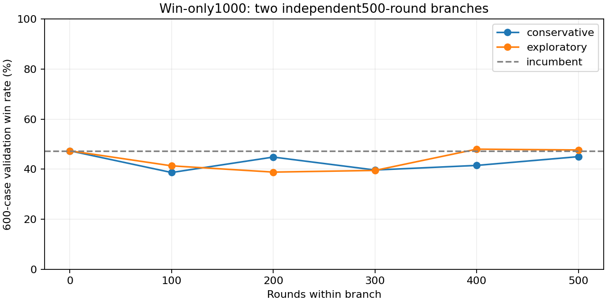

# 1000-round win-only experiment and frozen-opponent audit

## Outcome: no reliable extra improvement beyond v1.7

User authorized1000 learning rounds to improve wins versus unchanged AI-player Level0. Exactly1000 completed: two independent500-round branches from the **v1.7 selected round400 bot**, not one accumulated1000-round lineage. Physical rules remain v1.7: real desert Game::step,25HP rifle body/75head, normal weapon specs, shared uniform reaction population150ms mean/50msSD, random connected-map starts/headings, minimum8m separation. Only bot learns. Win reward1; losses/mutual deaths/timeouts0; no damage/time/exploration/switch rewards or discount. First-visit episodic MonteCarlo retained.

Conservative branch: alpha .05→.02, epsilon .12→.02. Exploratory branch: alpha .09→.04, epsilon .30→.05. Each branch continues its own checkpoints in100-round blocks, sharing no learning with the other. Configs, before/after tables, original frozen references, all1000 outcomes,100 ten-round bot checkpoints,50-round aggregates and initial locked plan preserved. Independent audit verified budget, seeds, win-only reward and frozen-player values.

Original selection plan: highest600-case validation wins among starting model and ten100-round checkpoints; ties starting/earlier. After seeing the strongest raw checkpoint barely improve (288/600 vs284), five fixed Q blends with incumbent were added, before any fresh test access. This is explicitly an **adaptive validation extension**, not a fully preregistered16-candidate search. Amendment records learned weights .1,.25,.5,.75,.9. No learning rounds added. Blend .5 and .75 tied291/600; earlier .5 selected. Selection locked and hashed before fresh testing; no subsequent retuning/reselection.

| Fresh1000 cases | Wins | Losses | Mutual deaths | Win rate | Mean damage | Mean taken |
|---|---:|---:|---:|---:|---:|---:|
| v1.7 incumbent |477|492|31|47.7%|62.625|57.9|
| Selected50/50 blend |479|445|76|47.9%|66.95|58.125|

No timeouts. Two extra wins is not reliable improvement:74 new wins but72 prior wins lost, paired one-sided exact p=.467; approximate paired95% interval for win-rate change−2.17 to+2.57 percentage points. **Safety gate failed; v1.7 remains default. No new game release or model replacement.** The blend mainly converted losses into mutual deaths, not wins.

Training seeds2900100–2900599 and3000100–3000599; validation3100000–3100599; original fresh3200000–3200999. Extra hypothesis probes use other seeds and do not replace the original fresh test. They do not tune or deploy a new candidate. Training source was Git54e1205; executable hash and policy identity recorded. Diagnostic controller timestep parameter defaults preserve original50ms behavior;50 golden episodes verified identical outcomes,ticks,damage and both shot counts.

## Validation checkpoints

| Candidate | Wins/600 | Win rate |
|---|---:|---:|
|baseline|284|47.33%|
|conservative-1|232|38.67%|
|conservative-2|269|44.83%|
|conservative-3|238|39.67%|
|conservative-4|249|41.50%|
|conservative-5|270|45.00%|
|exploratory-1|248|41.33%|
|exploratory-2|233|38.83%|
|exploratory-3|237|39.50%|
|exploratory-4|288|48.00%|
|exploratory-5|286|47.67%|
|blend-0.1|267|44.50%|
|blend-0.25|245|40.83%|
|blend-0.5|291|48.50%|
|blend-0.75|291|48.50%|
|blend-0.9|288|48.00%|

## Training progress (50-round blocks)

Branches restart from the same incumbent. Local branch rounds1–500 are not a single cumulative1000-round policy. Exploration enabled and encounters vary; block rates are not controlled evaluation gains. Winning time averages wins only; sniper kills include mutual deaths.

| Branch | Local rounds | Win rate | W/L/mutual | Damage | Taken | Hit rate | Mean win seconds | Sniper kills |
|---|---|---:|---|---:|---:|---:|---:|---:|
|conservative|1–50|40%|20/28/2|56.5|62.5|57.6%|10.63|9|
|conservative|51–100|50%|25/24/1|67.0|61.0|59.2%|10.75|6|
|conservative|101–150|36%|18/31/1|55.0|69.0|84.7%|15.76|3|
|conservative|151–200|42%|21/28/1|60.5|63.5|70.3%|13.90|4|
|conservative|201–250|42%|21/27/2|62.0|62.5|84.2%|13.75|6|
|conservative|251–300|40%|20/28/2|62.0|66.0|89.4%|14.89|4|
|conservative|301–350|44%|22/27/1|59.0|58.0|77.7%|16.55|1|
|conservative|351–400|50%|25/24/1|64.0|55.0|79.6%|16.21|1|
|conservative|401–450|34%|17/30/3|61.0|71.0|84.2%|18.71|2|
|conservative|451–500|42%|21/28/1|54.0|64.5|70.2%|23.59|8|
|exploratory|1–50|58%|29/19/2|71.0|48.0|72.3%|15.04|15|
|exploratory|51–100|34%|17/28/5|57.0|69.0|59.9%|11.26|8|
|exploratory|101–150|42%|21/22/7|66.5|63.5|73.4%|14.22|16|
|exploratory|151–200|30%|15/30/5|52.5|72.0|53.4%|12.39|6|
|exploratory|201–250|50%|25/24/1|69.0|53.0|68.4%|18.37|0|
|exploratory|251–300|18%|9/37/4|51.5|85.0|64.3%|15.62|3|
|exploratory|301–350|40%|20/28/2|60.5|66.5|50.2%|18.99|2|
|exploratory|351–400|50%|25/24/1|59.0|52.0|61.8%|15.56|3|
|exploratory|401–450|54%|27/22/1|69.0|52.5|61.2%|10.48|0|
|exploratory|451–500|32%|16/30/4|60.0|73.5|70.4%|14.64|0|

See **[DIAGNOSTIC-REPORT.md](DIAGNOSTIC-REPORT.md)** for tested spawn, model-identity, timestep, role/controller and state-aliasing hypotheses. Raw probe CSVs and reproducible C++ audit tools included in native/training. Original orchestration scripts retain workspace paths for provenance; reproduce individual rounds using each saved config/before policy and strike-campaign. No extra learning was performed by the diagnostics. Frozen-policy evaluation rounds are not training rounds.

Reproduction helper: orchestration/blend_policy.cpp implements the exact affine Q blend and uses a repository-relative include. Compile with a C++17 compiler and supply BASE LEARNED WEIGHT OUTPUT. Original runner scripts retain workspace paths and require adjustments outside the original workspace; all per-block configs and before policies support individual CLI reproduction without those scripts.
