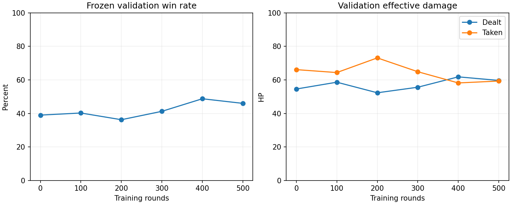

# Win-only learning:500 real-map rounds versus AI-player Level0

Exactly five100-round bot-only learning cycles, starting latest prior500-round final (reaction500/cycle5). AR-7 body25/head75 shared; real desert Game::step at0.05s; randomized valid connected starts and headings; both roles have independent per-encounter uniform reaction delay[63.397,236.603]ms, population mean150ms/SD50ms. Actual shots also require aim/readiness and are quantized by physics steps. The frozen opponent's Q values/visits remain unchanged, verified throughout. No simplified simulator or extra accumulated learning rounds.

## Reward and learning changes

Only reward:1 for a bot win,0 for loss/mutual death/timeout. Damage, time, damage taken, switching and exploration receive ZERO reward. No time discount. First-visit Monte Carlo updates each visited(state,executed action) once per episode with the terminal win indicator, alpha0.08, exploration0.20→0.04 within each100. First-visit updates avoid overweighting repeated frames from long games. Before training, old shaping-scale Q values were affinely rescaled PER STATE into[0.45,0.55]. An exhaustive192×511-mask audit proved ALL greedy decisions unchanged, including tie order. This is initialization calibration, not extra training or a hidden behavior change. Raw/calibrated source and audit preserved. Tests assert per-round reward equals win indicator and first-visit counts do not exceed1 per pair per episode.

Training seeds2600100–2600599; repeated validation400 cases2700000–2700399; untouched fresh final500 cases2800000–2800499. Selection rule fixed before fresh tests: most validation WINS ONLY among baseline and100/200/300/400/500 checkpoints; ties retain baseline/earlier. No damage/time tie-breaks. selection-locked-before-test.json records candidate hashes. All500 training rounds completed, including last100 after selected checkpoint400. No fresh-test-driven reselection or extra training.

## Validation progress

| Rounds | Wins/400 | Win rate | Losses | Mutual deaths | Timeouts | Mean damage | Mean taken | Hit rate | Mean winning seconds | Sniper kills |
|---|---:|---:|---:|---:|---:|---:|---:|---:|---:|---:|
|0|156|39.00%|238|6|0|54.56|66.12|54.5%|14.82|0|
|100|161|40.25%|232|7|0|58.62|64.38|64.9%|15.29|3|
|200|145|36.25%|238|17|0|52.31|73.12|56.0%|19.11|0|
|300|165|41.25%|230|5|0|55.62|64.88|55.2%|15.12|0|
|400|195|48.75%|193|12|0|61.81|58.19|67.0%|15.43|60|
|500|184|46.00%|203|12|1|59.69|59.31|53.9%|15.14|54|

## Fresh final test (no learning)

| Policy | Wins/500 | Win rate | Losses | Mutual deaths | Mean damage | Mean taken | Hit rate | Mean winning seconds | Sniper kills |
|---|---:|---:|---:|---:|---:|---:|---:|---:|---:|
|Starting bot|186|37.2%|300|14|54.10|68.30|52.8%|14.63|0|
|Selected checkpoint400|238|47.6%|253|9|61.70|58.85|65.1%|14.35|70|
|Final checkpoint500|229|45.8%|259|12|59.85|59.60|54.6%|13.69|61|

Selected checkpoint400 improved fresh win rate37.2→47.6% (+10.4 percentage points), damage54.1→61.7 and taken68.3→58.85. The final500 still improved to45.8%, but overwriting checkpoint400 would lose some observed gain. The fresh-test safety gate passed:68 previously non-winning cases became wins,16 wins lost, paired one-sided exact binomial p=4.27e-9. This measures one frozen controller and defined spawn distribution, not human matches, team play or universal intelligence. No claim of guaranteed future improvement. Raw discordant-case statistics preserved.

## Training progress every50

| Rounds | Win rate | W/L/mutual deaths | Mean damage | Mean taken | Hit rate | Mean win seconds | Sniper kills |
|---|---:|---|---:|---:|---:|---:|---:|
|1–50|38%|19/27/4|62.5|63.5|76.2%|21.22|4|
|51–100|42%|21/28/1|58.0|63.0|65.1%|14.01|0|
|101–150|44%|22/24/4|69.0|59.5|58.9%|15.59|2|
|151–200|28%|14/35/1|54.5|74.5|48.7%|17.34|1|
|201–250|38%|19/30/1|53.5|68.0|55.4%|15.62|5|
|251–300|48%|24/22/4|71.0|58.0|70.2%|12.89|3|
|301–350|42%|21/26/3|63.5|61.0|62.0%|16.25|4|
|351–400|36%|18/29/3|61.5|66.0|69.7%|16.79|3|
|401–450|48%|24/24/2|62.5|58.0|55.8%|15.68|9|
|451–500|42%|21/28/1|62.0|63.5|54.8%|18.60|3|

Training blocks use different random encounters and exploration; they are not controlled before/after evaluations. All training blocks had zero timeouts. Win rates include draws in denominator. Winning time excludes non-wins; the compared winning subsets differ. Hit rate is bot hits/shots. Damage is actual HP removed, not overkill. Sniper kills include mutual eliminations. Ready-visible-without-shot counters now exclude reaction delay but not aim misalignment. Visibility sampled before each50ms step; encounter counts are contiguous sight segments, not tactical battle labels.

Full configs, per-round CSVs,50 checkpoints(every10 rounds), before/after bot/player tables, frozen reference, calibration audit, selection decision and gate are included. Earlier shaped-reward reaction500 run is separate and regressed37→32% on its fresh100 tests; do not mix seeds/reward scales as learning gains. Reproduction uses strike-campaign with saved configs; run cycles1–5 sequentially on their before tables and same frozen player. v1.7 runtime will include the selected checkpoint400 and exact starting baseline, both under shared physical/reaction/search rules. No online learning during human play.
