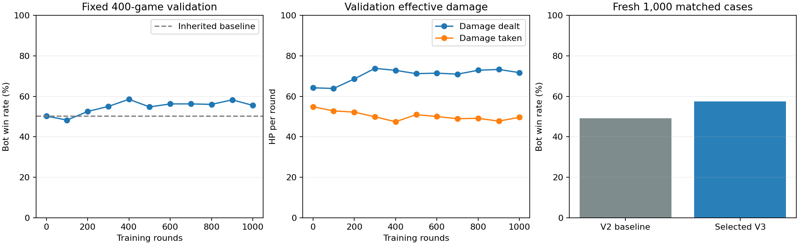

# Expanded Q-table V3: 1,000 real-map training rounds

## Result

The expanded learner improved against unchanged **AI-player Level0** on1,000 fresh matched cases. The selected checkpoint wins574/1000(57.4%) versus491/1000(49.1%) for the unchanged v1.7 V2 bot, a gain of8.3 percentage points. Paired gained218/lost135 wins; one-sided exact p=5.84e-6, approximate paired95% difference interval+4.65 to+11.95 points. This passes the predeclared improvement gate on this one frozen opponent/map-start distribution, not a guarantee for other opponents, humans or team play.

Exactly1,000 retained campaign learning rounds completed in one continuous lineage, ten100-round blocks. Checkpoint400 was selected by400-case validation wins BEFORE fresh tests. The final1,000-round checkpoint also wins574 fresh games, but selection was not changed based on fresh results. No extra learning after the budget or final test.

## Q expansion and behavior

| Property | V2 | V3 |
|---|---:|---:|
|Possible state combinations|192|49,152|
|Actions|9|12|
|Potential state-action values|1,728|589,824|
|Storage|Dense base table|Shared base/route priors plus learned sparse context rows|

V3 adds six binary features (aim alignment, own firing readiness including reaction/cooldown, usable cover within3m, finer range within each old bucket, visible enemy facing and visible enemy sniper), plus four own-position map regions.192×64×4=49,152. This is capacity, NOT a claim every state was visited. The selected model contains297 learned detailed rows; final1,000 model445. Unvisited contexts fall back to the inherited/shared base values. Smoothing uses prior strength2 to avoid treating rare contexts as fully learned.

Three added actions choose east, west and central cross-map search routes. Goals use world geometry and own location only, are checked for reachability, and have commitment timers rather than being rerolled every250ms. New sensory evidence cancels the commitment. Choice opportunities are recorded from the actual pre-choice mask; logged route_decisions count genuine route selections, not every committed repeat.

Enemy weapon/facing and live enemy position enter context only when actually visible. Hidden-target navigation/features use remembered evidence; tests vary hidden enemy location, facing and weapon without changing context/routes. Level0 retains its V2 policy and controller; only its timing is correctly advanced with the same120Hz physics as the bot. No hidden opponent reaction/cooldown/intent is exposed.

## Fixing measurement before learning

Physics step is1/120s for both actors; high-level choices remain250ms. All timers, AI aiming and reaction clocks use that step. Metric seconds use the stored step size rather than the old50ms multiplier. The runtime targets120FPS, though actual human rendering rates vary.

**A new baseline was established under these same rules.** The inherited but untrained V3 reproduces all400 V2 validation core fields exactly (outcomes, shots, damage, time and starting conditions). The older20Hz results are not compared as learning gains. Only contextual telemetry differs. An early baseline with a post-step route counter was retained for QA; the official baseline was rerun after recording choice masks at the actual decision. Core outcomes remained identical.

## Learning and locked protocol

Only reward:1 for a bot win,0 for loss/mutual death/timeout. No damage, speed, survival, exploration or switching rewards; no discount. Each(state,executed action) updates once per episode. The shared parent updates once per(base state,action), avoiding repeated-frame overcredit. Context alpha .12,parent .02 for first500; .08/.01 for last500. Exploration decreases continuously .25→.02 across the1,000 rounds.

The actual runtime chooses exploratory actions at its own decision point and records the executed context/action; no trainer-only action-time observation path is substituted. Source-as-trained snapshots, hashes and executable hash preserved. After-run formatting and malformed-config validation edits do not change the recorded valid protocol. Old/frozen policies are V2; student is V3. File parser validates schema, finite0–1 values, row/state bounds, counts and duplicates. Sparse counts persist between blocks.

Training seeds3700100–3701099; fixed validation3800000–3800399; fresh4000000–4000999. Unit fixtures use other seeds and are discarded, never retained as campaign learning. Level0 table values/visits remain unchanged; evaluation saves exact before/after policy files and asserts identity. Independent agent audited all1,000 outcomes/rewards, frozen hashes, lineage, source snapshots, selection and fresh gate.

Selection: maximum validation WINS only among inherited V3 baseline and checkpoints100–1000; ties prefer incumbent/earlier. No damage/time tie-break and no adaptive candidate expansion. The locked selection file names checkpoint400 and its hash before fresh testing.

## Validation progress (same400 cases, no learning/exploration)

| Rounds | Wins | Losses | Mutual deaths | Timeouts | Win rate | Avg damage | Avg taken | Hit rate | Mean winning seconds | Sparse rows |
|---|---:|---:|---:|---:|---:|---:|---:|---:|---:|---:|
|0|201|197|2|0|50.25%|64.19|54.81|72.2%|13.30|0|
|100|193|149|42|16|48.25%|63.88|52.81|81.2%|28.08|117|
|200|210|153|35|2|52.50%|68.56|52.19|80.4%|16.00|182|
|300|220|131|47|2|55.00%|73.81|49.88|79.6%|21.36|244|
|400|234|143|21|2|58.50%|72.81|47.44|76.6%|20.69|297|
|500|219|147|32|2|54.75%|71.19|50.94|76.2%|23.30|331|
|600|225|148|25|2|56.25%|71.44|50.00|79.5%|16.94|350|
|700|225|148|25|2|56.25%|70.94|48.94|79.3%|22.84|383|
|800|224|140|34|2|56.00%|72.88|49.12|76.8%|21.70|403|
|900|233|134|31|2|58.25%|73.25|47.75|79.7%|21.58|427|
|1000|222|145|31|2|55.50%|71.69|49.62|79.0%|23.39|445|

## Fresh final test (same1,000 cases, no learning)

| Model | Wins | Losses | Mutual deaths | Timeouts | Win rate | Avg damage | Avg taken | Hit rate | Mean winning seconds | Sniper kills |
|---|---:|---:|---:|---:|---:|---:|---:|---:|---:|---:|
|v1.7 V2baseline|491|503|6|0|49.1%|61.550|54.65|65.3%|13.54|109|
|SelectedV3 checkpoint400|574|367|56|3|57.4%|70.075|46.80|74.0%|20.82|243|
|FinalV3 checkpoint1000|574|353|70|3|57.4%|71.050|47.65|73.0%|23.22|242|

**Tradeoffs:** selected V3 takes longer to win13.54→20.82s, and mutual deaths increase6→56, timeouts0→3. The speed slowdown persists on356 cases won by both:14.19→19.23s. This run optimized winning only; do not describe it as faster or universally better on every metric. Damage and timing are reporting metrics, not rewards or selection criteria. Sniper kills include mutual deaths.

## Every50 training rounds

Exploration enabled and different random encounters; these block rates are not controlled evaluation gains. Winning time excludes losses/draws; timeouts separate.

| Rounds | Win rate | W/L/mutual | Timeouts | Avg damage | Avg taken | Hit rate | Mean win seconds | Sniper kills | Route selections |
|---|---:|---|---:|---:|---:|---:|---:|---:|---:|
|1–50|50%|25/16/3|6|59.5|42.5|74.6%|38.33|11|55|
|51–100|44%|22/15/8|5|63.5|47.5|83.0%|28.90|15|52|
|101–150|40%|20/20/9|1|62.5|59.5|68.2%|13.40|18|48|
|151–200|34%|17/20/6|7|49.0|57.5|57.9%|25.53|10|48|
|201–250|64%|32/7/3|8|71.5|25.0|80.7%|23.75|16|48|
|251–300|52%|26/18/4|2|63.0|53.5|81.8%|22.67|9|47|
|301–350|58%|29/16/4|1|73.0|49.5|82.9%|22.22|12|54|
|351–400|40%|20/23/5|2|59.5|60.5|80.6%|15.47|11|56|
|401–450|64%|32/13/1|4|72.5|35.0|84.3%|27.04|3|52|
|451–500|66%|33/15/2|0|75.5|36.5|69.9%|20.37|13|50|
|501–550|46%|23/23/3|1|61.0|55.5|81.0%|26.25|8|49|
|551–600|48%|24/21/2|3|58.5|46.0|76.0%|14.93|14|49|
|601–650|58%|29/14/4|3|69.0|39.0|65.4%|13.82|16|47|
|651–700|60%|30/15/5|0|78.0|43.0|79.7%|30.40|12|53|
|701–750|56%|28/19/3|0|67.5|50.0|75.0%|27.15|11|48|
|751–800|48%|24/22/1|3|62.5|49.5|69.9%|29.89|8|55|
|801–850|58%|29/20/1|0|66.0|51.5|81.5%|29.83|6|50|
|851–900|50%|25/24/1|0|62.5|53.5|70.1%|19.80|6|53|
|901–950|60%|30/16/2|2|66.0|40.0|81.4%|16.29|10|49|
|951–1000|58%|29/19/1|1|66.5|48.5|81.3%|31.46|8|50|

## Candidate source, tests and security status

Unreleased source candidate v1.8 loads selected `native/assets/bot-policy-context-v3.txt` by default and F5 compares the unchanged v1.7 baseline. Source integration uses actual Game context inference; no online learning during human play. Old released ZIPs/tags remain intact. No claim of improved six-bot human play; graphical Windows playtesting remains outstanding.

Source candidate09e1618 passed51 native gameplay checks on Linux/Windows and three training suites (mechanics, campaign, contextual). CI https://github.com/tffere/tffere-strike/actions/runs/42765187660 and https://github.com/tffere/tffere-strike/actions/runs/42765187650 . Tests include all49,152 encoding indices, warm inheritance parity, pure rewards/first-visit counts, sparse persistence, hidden-feature isolation, distinct reachable search routes, source asset loading and restart/legacy comparison. Additional parser/context distinctions also pass locally.

**No new Windows release ZIP is published while the reported v1.7 antivirus alert lacks its product/detection details.** Updated Defender recheck of the exact old v1.7 package reported no threats, but this does not establish a false positive or prove safety. See docs/security/v1.7/alert-2026-11-10/REPORT.md. The source/model training work does not resolve that alert and never executed the flagged EXE.

## Reproduction and provenance

Build `native/training`, target strike-context-trainer. `init V2 OUTPUT` creates inherited V3; `run V3 LEVEL0 EMPTY_OUT CYCLE CONFIG [test-only]` learns/evaluates; `legacy V2 LEVEL0 EMPTY_OUT 0 CONFIG` evaluates the old model under the same120Hz rules. Each saved config/before table reproduces its block. Source-as-trained snapshot preserves the exact compiled headers/entry point, matched to PLAN-LOCKED hashes. Original orchestration retains workspace paths; use fresh output directories when reproducing. Exact stochastic trajectories require the same compiler/runtime.

All raw rounds, before/after/evaluation policy files, frozen references, per-block configs, source snapshots, validation/selection records and safety gate are preserved. No post-fresh retuning/reselection or added learning beyond the1,000 campaign rounds.
